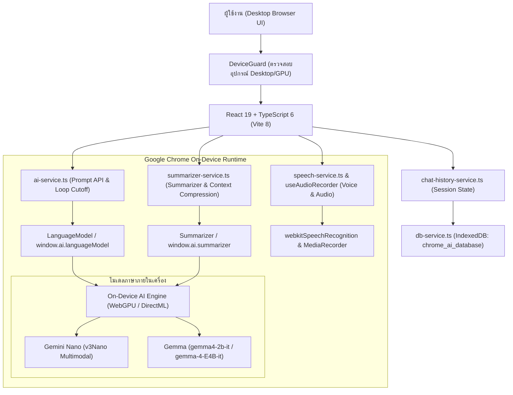

# Chrome Built-in AI Chatbot

[](https://developer.chrome.com/docs/ai/built-in)
[](https://deepmind.google/technologies/gemma/)
[](https://react.dev/)
[](https://www.typescriptlang.org/)
[](https://vite.dev/)
[](https://tailwindcss.com/)

เว็บแอปพลิเคชันแชทบอทที่ประมวลผลโมเดลภาษาบนอุปกรณ์ของผู้ใช้โดยตรง (On-Device AI) ผ่าน Chrome Built-in AI (`Prompt API` และ `Summarizer API`) ข้อความ รูปภาพ และไฟล์เสียงทั้งหมดประมวลผลผ่าน GPU ในเครื่องโดยไม่ส่งข้อมูลออกไปยังเซิร์ฟเวอร์ภายนอก

> [!NOTE]
> โครงการสหกิจศึกษา (Cooperative Education Project) ภาควิชาวิศวกรรมคอมพิวเตอร์ (CPE)

---

## ความสามารถหลัก

### 1. ประมวลผลในเครื่องและรักษาความเป็นส่วนตัว
ประมวลผลข้อความ รูปภาพ และเสียงผ่าน WebGPU บนเครื่องของผู้ใช้ทั้งหมด ข้อมูลการสนทนาไม่ถูกส่งออกไปยังคลาวด์ภายนอก จึงช่วยลดความเสี่ยงด้านข้อมูลรั่วไหลและสอดคล้องกับแนวทางคุ้มครองข้อมูลส่วนบุคคล (PDPA)

### 2. ใช้งานแบบออฟไลน์ได้ทันที
เมื่อเบราว์เซอร์ดาวน์โหลดโมเดลลงเครื่องเสร็จสมบูรณ์แล้ว คุณสามารถสนทนา วิเคราะห์รูปภาพ วิเคราะห์เสียง และสรุปเนื้อหาได้โดยไม่ต้องเชื่อมต่ออินเทอร์เน็ต พร้อมแสดงคำตอบแบบสตรีมมิ่ง (Real-time Streaming) โดยไม่มีความหน่วงจากเครือข่าย

### 3. รองรับข้อมูลหลายรูปแบบ (Multimodal: ข้อความ รูปภาพ และเสียง)
* **การวิเคราะห์รูปภาพ (Vision Input):** แนบไฟล์ภาพ (`PNG`, `JPG`, `WebP`, `GIF`) ได้สูงสุด 8 รูปต่อครั้ง (ขนาดไม่เกิน 10 MB ต่อภาพ) หรือวางภาพจากคลิปบอร์ดด้วย `Ctrl+V` / `Cmd+V` พร้อมหน้าต่างดูภาพขนาดเต็ม (Lightbox) และปุ่มดาวน์โหลด
* **การวิเคราะห์ไฟล์เสียงและบันทึกเสียงสด (Audio Input):** แนบไฟล์เสียง (`MP3`, `WAV`, `OGG`, `M4A`, `WebM`, `AAC`, `FLAC`) ขนาดไม่เกิน 25 MB หรืออัดเสียงสดผ่านไมโครโฟนด้วย `MediaRecorder` เพื่อส่งให้โมเดลวิเคราะห์เสียงโดยตรง
* **พิมพ์ด้วยเสียง (Speech-to-Text):** แปลงเสียงพูดภาษาไทย (`th-TH`) และภาษาอังกฤษ (`en-US`) เป็นข้อความอัตโนมัติผ่าน `Web Speech API`

### 4. ย่อบริบทและจัดการหน่วยความจำอัตโนมัติ (Context Compression)
ติดตามปริมาณโทเค็นในหน้าต่างบริบท (สูงสุด 9,216 โทเค็น) แบบเรียลไทม์ เมื่อใช้โทเค็นเกิน 88% หรือเหลือพื้นที่ว่างน้อยกว่า 500 โทเค็น ระบบจะเรียกใช้ `Summarizer API` เพื่อบีบอัดประวัติการสนทนาเดิมให้กระชับโดยอัตโนมัติ ช่วยให้คุยต่อเนื่องได้โดยไม่เกิดปัญหาข้อความล้นโควตา

### 5. จัดเก็บประวัติการแชทด้วย IndexedDB
บันทึกห้องสนทนา ข้อความ รวมถึงไฟล์แนบรูปภาพและเสียงลงในฐานข้อมูล `IndexedDB` (`chrome_ai_database`) ของเบราว์เซอร์โดยอัตโนมัติ รองรับการโอนย้ายข้อมูลเก่าจาก `LocalStorage` อัตโนมัติ พร้อมแถบด้านข้าง (Sidebar) สำหรับค้นหาแชทเก่า สลับห้องสนทนา เปลี่ยนชื่อหัวข้อ ดูปริมาณพื้นที่จัดเก็บ และลบประวัติ

### 6. ระบบความปลอดภัยและตรวจสอบความเข้ากันได้ของอุปกรณ์
* **ตรวจสอบอุปกรณ์อัตโนมัติ (`DeviceGuard`):** อนุญาตเฉพาะคอมพิวเตอร์ Desktop และ Laptop ที่รองรับ Chrome On-Device AI และบล็อกอุปกรณ์พกพา (iPhone, iPad รวมถึงโหมดขอเว็บไซต์เดสก์ท็อปบน iPadOS และ Android) พร้อมแสดงหน้าจออธิบายสาเหตุอย่างชัดเจน
* **คัดกรองคำหยาบคาย (`Profanity Filter`):** ตรวจสอบคำไม่สุภาพทั้งภาษาไทยและภาษาอังกฤษ (รองรับการตรวจจับคำควบและการเว้นวรรคแฝง) โดยเปิดหรือปิดการคัดกรองได้จากหน้าตั้งค่า
* **ตัดลูปข้อความซ้ำและสลับโหมดจำลอง (`Mock Mode`):** หยุดการสร้างข้อความอัตโนมัติเมื่อตรวจพบว่าโมเดลตอบซ้ำวนลูป และสลับเข้าสู่โหมดจำลองอัตโนมัติเมื่อเปิดบนเบราว์เซอร์ที่ยังไม่ได้ตั้งค่า Flags เพื่อให้ทดสอบส่วนติดต่อผู้ใช้ได้ครบทุกฟังก์ชัน

---

## สถาปัตยกรรมของระบบ



---

## การเตรียมความพร้อมและตั้งค่า Chrome Built-in AI

ทำตาม 3 ขั้นตอนต่อไปนี้เพื่อเปิดใช้งานโมเดล AI บนเบราว์เซอร์ Google Chrome ของคุณ

### 1. ตรวจสอบความต้องการของระบบ
* **อุปกรณ์:** คอมพิวเตอร์ Desktop หรือ Laptop (ระบบปฏิบัติการ Windows 10/11, macOS 13 ขึ้นไป, Linux หรือ ChromeOS)
* **เบราว์เซอร์:** Google Chrome เวอร์ชัน 138 ขึ้นไป (แนะนำ Chrome Dev หรือ Chrome Canary สำหรับการวิเคราะห์รูปภาพและเสียง)
* **พื้นที่เก็บข้อมูล:** พื้นที่ว่างอย่างน้อย 22 GB ในไดรฟ์ที่ติดตั้งโปรไฟล์ Chrome เพื่อเก็บไฟล์โมเดล
* **หน่วยประมวลผลกราฟิก (GPU):** VRAM มากกว่า 4 GB หรือ Integrated GPU รุ่นใหม่ที่รองรับ WebGPU

> [!IMPORTANT]
> Chrome Built-in AI ไม่รองรับการทำงานบน iPhone (iOS), iPad (iPadOS) และสมาร์ตโฟนหรือแท็บเล็ตระบบ Android

### 2. เปิดใช้งาน Flags ใน Google Chrome
คัดลอกที่อยู่ด้านล่างไปวางในแถบค้นหาของ Chrome ทีละรายการ แล้วเปลี่ยนค่าให้ตรงตามที่ระบุ:

| ลำดับ | ที่อยู่ Flag | ค่าที่ต้องเลือก | คำอธิบาย |
| :--- | :--- | :--- | :--- |
| 1 | `chrome://flags/#prompt-api-for-gemini-nano` | **Enabled** | เปิดใช้งาน Prompt API หลัก |
| 2 | `chrome://flags/#prompt-api-for-gemini-nano-multimodal-input` | **Enabled** | รองรับการแนบรูปภาพและไฟล์เสียง |
| 3 | `chrome://flags/#summarization-api-for-gemini-nano` | **Enabled** | เปิดใช้งาน Summarizer API สำหรับสรุปเนื้อหา |
| 4 | `chrome://flags/#optimization-guide-on-device-model` | **Enabled BypassPerfRequirement** | อนุญาตให้ดาวน์โหลดโมเดลลงเครื่องโดยข้ามเกณฑ์ตรวจสอบเบื้องต้น |
| 5 | `chrome://flags/#enable-experimental-web-platform-features` | **Enabled** | เปิดฟีเจอร์ทดลองของ Web Platform |

หลังจากตั้งค่าครบทุกรายการ ให้กดปุ่ม **Relaunch** ที่มุมขวาล่างของเบราว์เซอร์

### 3. อัปเดตและดาวน์โหลดโมเดลลงเครื่อง
1. เปิดแท็บใหม่แล้วไปที่ `chrome://components`
2. ค้นหาหัวข้อ **Optimization Guide On Device Model**
3. กดปุ่ม **Check for update** เพื่อเริ่มดาวน์โหลดโมเดล
4. รอจนกว่าสถานะจะเปลี่ยนเป็น **Up-to-date** (ความเร็วขึ้นอยู่กับอินเทอร์เน็ตของคุณ)
5. ปิดและเปิด Google Chrome ใหม่อีกครั้งเพื่อเริ่มใช้งาน

---

## การติดตั้งและเริ่มต้นพัฒนา

### 1. เข้าสู่โฟลเดอร์แอปพลิเคชัน
```bash
cd chat-bot
```

### 2. ติดตั้งแพ็กเกจที่จำเป็น
```bash
npm install
```

### 3. รันเซิร์ฟเวอร์สำหรับการพัฒนา
```bash
npm run dev
```
เปิดเบราว์เซอร์ Google Chrome ไปที่ `http://localhost:5173` เพื่อใช้งานแอปพลิเคชัน

### 4. คำสั่งตรวจสอบโค้ดและสร้างไฟล์สำหรับใช้งานจริง
```bash
# ตรวจสอบคุณภาพโค้ดด้วย ESLint
npm run lint

# คอมไพล์ TypeScript และสร้างไฟล์ Production Build ลงในโฟลเดอร์ dist/
npm run build

# ทดสอบรันไฟล์ Production Build บนเครื่อง
npm run preview

# อัปโหลดขึ้น Firebase Hosting
npm run deploy
```

### 5. รันด้วย Docker (ทางเลือก)
โปรเจกต์มี `Dockerfile` แบบ Multi-stage (Node 20 Alpine สำหรับ Build และ Nginx Alpine สำหรับให้บริการ SPA บนพอร์ต 80):
```bash
cd chat-bot
docker build -t chrome-builtin-ai-chatbot .
docker run -p 8080:80 chrome-builtin-ai-chatbot
```
จากนั้นเปิดเบราว์เซอร์ไปที่ `http://localhost:8080`

---

## โครงสร้างโปรเจกต์

```text
Built-In-AI-API/
├── README.md                                   # เอกสารหลักของโครงการ
└── chat-bot/                                   # แอปพลิเคชัน React Frontend
    ├── Dockerfile                              # การตั้งค่า Container (Node 20 + Nginx)
    ├── firebase.json                           # การตั้งค่าสำหรับ Deploy ขึ้น Firebase Hosting
    ├── index.html                              # โครงสร้าง HTML หลัก
    ├── package.json                            # รายการ Dependencies และคำสั่ง Scripts
    ├── tsconfig.json                           # การตั้งค่า TypeScript
    ├── vite.config.ts                          # การตั้งค่า Vite และ Tailwind CSS v4
    └── src/
        ├── components/                         # ส่วนประกอบ UI (Components)
        │   ├── ChatHeader.tsx                  # แถบด้านบนแสดงสถานะโมเดล โควตาโทเค็น และปุ่มควบคุม
        │   ├── ChatHistorySidebar.tsx          # แถบประวัติการแชท ค้นหา เปลี่ยนชื่อ และดูพื้นที่จัดเก็บ
        │   ├── ChatMessage.tsx                 # กล่องข้อความแชท เรนเดอร์ Markdown รูปภาพ และเครื่องเล่นเสียง
        │   ├── DeviceGuard.tsx                 # ตัวกรองตรวจสอบอุปกรณ์ก่อนเข้าใช้งานแอปพลิเคชัน
        │   ├── PolicyModal.tsx                 # หน้าต่างแสดงข้อกำหนดและนโยบายความปลอดภัยของ AI
        │   ├── SettingsModal.tsx               # หน้าต่างปรับแต่ง Temperature, Top-K, System Prompt และตัวกรองคำหยาบ
        │   ├── SteppedRangeSlider.tsx          # แถบเลื่อนปรับค่าพารามิเตอร์แบบกำหนดช่วง
        │   ├── SummaryModal.tsx                # หน้าต่างสรุปเนื้อหาบทสนทนาด้วย Summarizer API
        │   ├── Toast.tsx                       # แถบแจ้งเตือนสถานะและข้อผิดพลาดชั่วคราว
        │   └── UnsupportedDeviceScreen.tsx     # หน้าจอแจ้งเตือนเมื่อเปิดใช้งานบนมือถือหรือแท็บเล็ตที่ไม่รองรับ
        ├── hooks/                              # Custom React Hooks
        │   ├── index.ts                        # จุดรวมการส่งออก Hooks
        │   ├── useAudioRecorder.ts             # จัดการการบันทึกเสียงผ่านไมโครโฟนด้วย MediaRecorder
        │   ├── useMultimodalAttachments.ts     # จัดการการแนบและตรวจสอบไฟล์รูปภาพและเสียง
        │   └── useSpeechRecognition.ts         # จัดการการแปลงเสียงพูดเป็นข้อความ (Speech-to-Text)
        ├── pages/
        │   └── ai-prompt.tsx                   # หน้าจอหลักของระบบแชทบอท
        ├── services/                           # ชั้นเชื่อมต่อ API และฐานข้อมูล
        │   ├── ai-service.ts                   # ควบคุม Prompt API, Multimodal Input และการตัดลูปข้อความซ้ำ
        │   ├── chat-history-service.ts         # จัดการสถานะห้องสนทนาและซิงก์ข้อมูลแบบเรียลไทม์
        │   ├── db-service.ts                   # จัดการฐานข้อมูล IndexedDB และการโอนย้ายจาก LocalStorage
        │   ├── speech-service.ts               # บริการเชื่อมต่อ Web Speech API
        │   └── summarizer-service.ts           # ควบคุม Summarizer API และการบีบอัดบริบทอัตโนมัติ
        ├── types/
        │   ├── ai.d.ts                         # Type Definitions สำหรับ Chrome Built-in AI APIs
        │   └── chat-history.ts                 # โครงสร้างข้อมูลประวัติการสนทนา
        ├── utils/
        │   ├── device-detection.ts             # ตรวจสอบประเภทอุปกรณ์ ระบบปฏิบัติการ และ WebGPU
        │   ├── id.ts                           # สร้างรหัสอ้างอิงเฉพาะ (Unique ID)
        │   ├── markdown.ts                     # จัดการข้อความ Markdown และแปลงเป็นข้อความล้วน
        │   └── profanity-filter.ts             # ตรวจสอบและคัดกรองคำหยาบคายภาษาไทยและอังกฤษ
        ├── App.tsx                             # คอมโพเนนต์รากของแอปพลิเคชัน
        ├── main.tsx                            # จุดเริ่มต้นการเรนเดอร์ React
        └── index.css                           # สไตล์หลักและตัวแปรธีม
```

---

## การแก้ไขปัญหาเบื้องต้น (Troubleshooting)

| อาการที่พบ (What happened) | สาเหตุ (Why it happened) | วิธีแก้ไข (How to fix) |
| :--- | :--- | :--- |
| แถบสถานะขึ้นว่า **Mock Mode** | เบราว์เซอร์ยังไม่ได้เปิดใช้งาน Flags หรือยังดาวน์โหลดโมเดลไม่เสร็จ | เปิดใช้งาน Flags ทั้งหมดในหัวข้อที่ 2 กด **Relaunch** แล้วไปกด **Check for update** ที่ `chrome://components` |
| ไม่พบรายการ **Optimization Guide On Device Model** ใน `chrome://components` | Chrome ยังไม่เคยถูกกระตุ้นให้เรียกใช้โมเดลในเครื่อง | เปิด `chrome://flags/#optimization-guide-on-device-model` เลือก **Enabled BypassPerfRequirement** กด **Relaunch** แล้วเปิดหน้าเว็บแอปพลิเคชันนี้อีกครั้ง |
| แนบรูปภาพหรือไฟล์เสียงไม่ได้ | ยังไม่ได้เปิด Flag สำหรับข้อมูลหลายรูปแบบ (Multimodal) หรือไฟล์มีขนาดเกินกำหนด | เปิด `chrome://flags/#prompt-api-for-gemini-nano-multimodal-input` เป็น **Enabled** และตรวจสอบว่าไฟล์ภาพไม่เกิน 10 MB หรือไฟล์เสียงไม่เกิน 25 MB |
| ปรากฏหน้าจอแจ้งเตือนอุปกรณ์ไม่รองรับ | เปิดใช้งานผ่าน iPhone, iPad หรืออุปกรณ์ระบบ Android ซึ่งไม่มี Chrome On-Device AI | เปลี่ยนไปเปิดใช้งานผ่านเบราว์เซอร์ Google Chrome บนคอมพิวเตอร์ Desktop หรือ Laptop |

---

## เทคโนโลยีที่ใช้พัฒนา

* **Frontend Framework:** [React 19.2](https://react.dev/), [TypeScript 6.0](https://www.typescriptlang.org/), [Vite 8.3](https://vite.dev/)
* **On-Device AI Runtime:** [Chrome Built-in AI (Prompt API & Summarizer API)](https://developer.chrome.com/docs/ai/built-in)
* **Local Database:** Browser `IndexedDB API` พร้อมระบบโอนย้ายข้อมูลจาก `LocalStorage`
* **Styling & Icons:** [Tailwind CSS v4.3](https://tailwindcss.com/), [Lucide React](https://lucide.dev/)
* **Markdown Rendering:** [react-markdown](https://github.com/remarkjs/react-markdown), [remark-gfm](https://github.com/remarkjs/remark-gfm)
* **Deployment:** [Docker (Nginx Alpine)](https://www.docker.com/), [Firebase Hosting](https://firebase.google.com/docs/hosting)