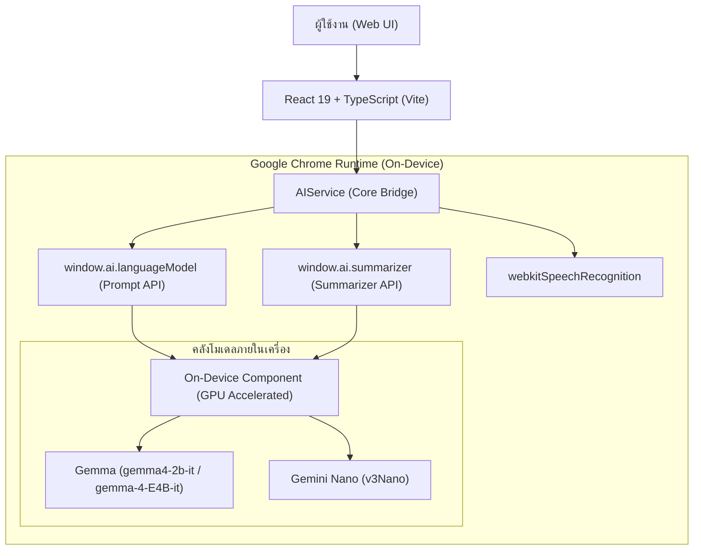

# Chrome Built-in AI Chatbot (Prompt API & Summarizer API)

[](https://developer.chrome.com/docs/ai/built-in)
[](https://deepmind.google/technologies/gemma/)
[](https://react.dev/)
[](https://www.typescriptlang.org/)
[](https://vitejs.dev/)
[](https://tailwindcss.com/)

เว็บแอปพลิเคชันแชทบอทที่รันโมเดลภาษาบนเครื่องของผู้ใช้โดยตรง (On-Device AI) ผ่าน Chrome Built-in AI (Prompt API และ Summarizer API) โดยใช้โมเดล Gemma และ Gemini Nano จาก Google DeepMind ข้อความและรูปภาพทั้งหมดประมวลผลผ่าน GPU ในเครื่อง ไม่ต้องส่งข้อมูลไปยังเซิร์ฟเวอร์ภายนอก

> โครงการสหกิจศึกษา (Cooperative Education Project), ภาควิชาวิศวกรรมคอมพิวเตอร์ (CPE)

## คุณสมบัติการทำงาน

### ความเป็นส่วนตัวและการประมวลผลในเครื่อง
ข้อความ รูปภาพ และเสียงประมวลผลในเครื่องของผู้ใช้ผ่าน GPU ทั้งหมด ไม่มีการส่งข้อมูลออกไปยังคลาวด์ภายนอก จึงปลอดภัยต่อข้อมูลส่วนบุคคลตามแนวทาง PDPA

### ใช้งานได้โดยไม่ต้องเชื่อมต่ออินเทอร์เน็ต
เมื่อเบราว์เซอร์ดาวน์โหลดโมเดลเข้าเครื่องเรียบร้อยแล้ว สามารถแชท ถามตอบ วิเคราะห์รูปภาพ และสรุปเนื้อหาได้ทันทีแม้ไม่ได้เชื่อมต่ออินเทอร์เน็ต และส่งข้อความตอบกลับแบบสตรีมมิ่งโดยไม่มีความหน่วงจากเครือข่าย

### วิเคราะห์รูปภาพ (Multimodal vision)
รองรับการแนบไฟล์ภาพ PNG, JPG, WebP หรือวางภาพจากคลิปบอร์ดด้วย Ctrl+V เพื่อให้โมเดลตอบคำถามเกี่ยวกับรูปภาพ พร้อมหน้าต่างแสดงภาพขนาดเต็มและปุ่มดาวน์โหลด

### จัดการหน่วยความจำและย่อบริบทอัตโนมัติ
ระบบติดตามจำนวนโทเค็นใน context window (สูงสุด 9,216 โทเค็น) เมื่อโทเค็นเกิน 88% หรือเหลือไม่ถึง 500 โทเค็น ระบบจะเรียกใช้ Chrome Summarizer API สรุปประวัติการคุยเดิมเป็นบริบทสั้นๆ อัตโนมัติ เพื่อป้องกันปัญหาข้อความล้นโควตาและให้สนทนาต่อเนื่องได้

### พิมพ์ข้อความด้วยเสียง
แปลงเสียงพูดเป็นข้อความได้ทั้งภาษาไทยและภาษาอังกฤษ โดยใช้ระบบ Speech Recognition ที่รันบนอุปกรณ์ของ Chrome

### การป้องกันข้อผิดพลาดและโหมดจำลอง
ระบบตรวจจับและตัดลูปข้อความซ้ำอัตโนมัติ หากโมเดลเริ่มสร้างตัวอักษรหรือประโยคเดิมซ้ำๆ และหากเปิดใช้งานบนเบราว์เซอร์ที่ยังไม่ได้เปิด Flags ระบบจะสลับไปใช้ Mock mode เพื่อให้ยังสามารถทดสอบ UI, markdown, การแสดงโค้ด และฟังก์ชันต่างๆ ได้

## สถาปัตยกรรมของระบบ

แผนภาพการทำงานของระบบและโมเดลที่เชื่อมต่อกับ Chrome on-device runtime:



โมเดลหลักที่ใช้งานคือ Gemma ขนาด 2B และ 4B (multimodal) ที่บีบอัดระดับ 4-bit (INT4) สำหรับรันบน GPU ของเครื่องผู้ใช้ผ่าน WebGPU หรือ DirectML นอกจากนี้ระบบยังรองรับ Gemini Nano เป็นโมเดลทางเลือก

## การตั้งค่า Chrome Built-in AI

เพื่อให้ Google Chrome สามารถรันโมเดล AI ในเครื่องได้ ให้ตั้งค่าตามขั้นตอนต่อไปนี้:

### 1. ความต้องการของระบบ
* Google Chrome เวอร์ชัน 138 ขึ้นไป (แนะนำ Chrome Dev หรือ Chrome Canary)
* พื้นที่ว่างในไดรฟ์ C: อย่างน้อย 10-22 GB สำหรับดาวน์โหลดโมเดล
* การ์ดจอแยก VRAM 4 GB ขึ้นไป หรือ Integrated GPU รุ่นใหม่

### 2. เปิดใช้งาน Flags ใน Chrome
เปิดแท็บใหม่ใน Chrome แล้วตั้งค่า flags ต่อไปนี้:
1. `chrome://flags/#prompt-api` เลือก Enabled
2. `chrome://flags/#prompt-api-for-gemini-nano-multimodal-input` เลือก Enabled (สำหรับการส่งรูปภาพ)
3. `chrome://flags/#gemma4-for-built-in-ai` เลือก Enabled (หากมี)
4. `chrome://flags/#optimization-guide-on-device-model` เลือก Enabled BypassPerfRequirement
5. `chrome://flags/#enable-experimental-web-platform-features` เลือก Enabled

### 3. ดาวน์โหลดคอมโพเนนต์โมเดลเข้าเครื่อง
1. ไปที่ `chrome://components`
2. ค้นหาหัวข้อ Optimization Guide On Device Models (หรือ Optimization Guide Models Manifest)
3. กดปุ่ม Check for update
4. รอจนกว่าสถานะจะเปลี่ยนเป็น Up-to-date หรือดาวน์โหลดเสร็จสมบูรณ์
5. ปิดแล้วเปิด Google Chrome ใหม่อีกครั้ง

## โครงสร้างโปรเจกต์

```text
Built-In-AI-API/
├── README.md               # เอกสารโครงการ
└── chat-bot/               # แอปพลิเคชัน React Frontend
    ├── public/             # ไฟล์ Static Assets
    ├── src/
    │   ├── components/     # UI Components
    │   │   ├── ChatHeader.tsx          # แถบ Header แสดงสถานะ Badge และปุ่มคำสั่ง
    │   │   ├── ChatMessage.tsx         # กล่องข้อความแชท, Markdown, Lightbox
    │   │   ├── PolicyModal.tsx         # หน้าต่างข้อกำหนดนโยบายความปลอดภัย AI
    │   │   ├── SettingsModal.tsx       # หน้าต่างตั้งค่าอุณหภูมิ (Temperature, Top-K)
    │   │   ├── SummaryModal.tsx        # หน้าต่างสรุปเนื้อหาบทสนทนา (Summarizer)
    │   │   └── SteppedRangeSlider.tsx  # Slider ปรับค่าพารามิเตอร์
    │   ├── pages/
    │   │   └── ai-prompt.tsx           # หน้าจอหลักของระบบแชทบอท
    │   ├── services/       # Service Layer เชื่อมต่อกับเบราว์เซอร์
    │   │   ├── ai-service.ts           # ควบคุม Prompt API, Session, Repetition Loop Cutoff
    │   │   ├── summarizer-service.ts   # ควบคุม Summarizer API และ Context Compression
    │   │   └── speech-service.ts       # ควบคุมระบบพิมพ์ด้วยเสียง Speech-to-Text
    │   ├── types/
    │   │   └── ai.d.ts                 # Type Definitions ของ Chrome Built-in AI
    │   ├── utils/
    │   │   └── markdown.ts             # เครื่องมือจัดการข้อความ Markdown และ Plain Text
    │   ├── App.tsx
    │   ├── main.tsx
    │   └── index.css
    ├── package.json
    ├── tsconfig.json
    └── vite.config.ts
```

## การติดตั้งและเริ่มใช้งาน

### 1. เข้าสู่โฟลเดอร์โปรเจกต์
```bash
cd Built-In-AI-API/chat-bot
```

### 2. ติดตั้ง Dependencies
```bash
npm install
```

### 3. รันเซิร์ฟเวอร์สำหรับการพัฒนา
```bash
npm run dev
```
เปิดเบราว์เซอร์ไปที่ `http://localhost:5173` เพื่อเริ่มใช้งาน

### 4. ตรวจสอบโค้ดและทดสอบ Build
```bash
# ตรวจสอบ Code Quality & Linter
npm run lint

# ทดสอบคอมไพล์ TypeScript และ Build โปรดักชัน
npm run build
```

## เทคโนโลยีที่ใช้งาน

* Core: [React 19](https://react.dev/), [TypeScript 5](https://www.typescriptlang.org/), [Vite](https://vitejs.dev/)
* AI Runtime: [Chrome Built-in AI (Prompt API & Summarizer API)](https://developer.chrome.com/docs/ai/built-in)
* Styling: [Tailwind CSS v4](https://tailwindcss.com/)
* Icons: [Lucide React](https://lucide.dev/)
* Markdown: [react-markdown](https://github.com/remarkjs/react-markdown), [remark-gfm](https://github.com/remarkjs/remark-gfm)

